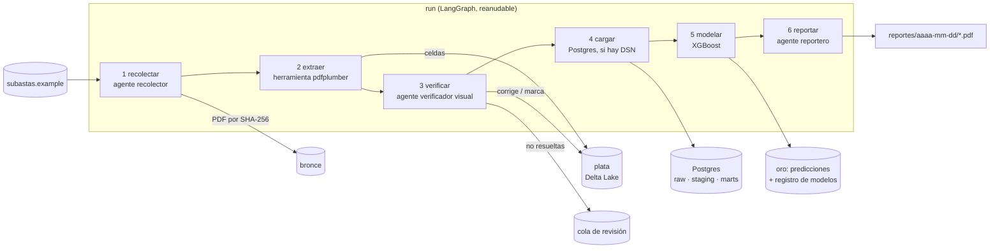
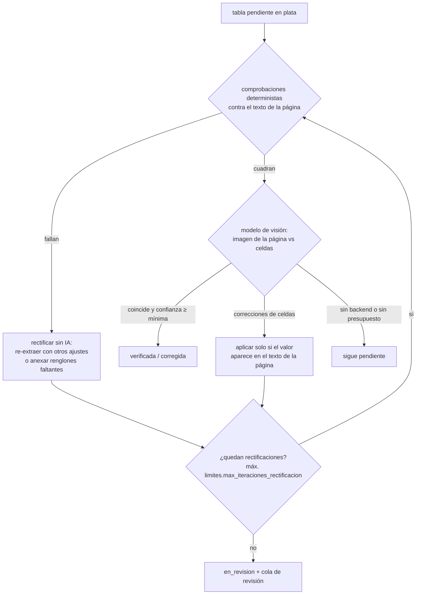

# Predicción ganadera

Sistema multiagente que recolecta los resúmenes de subastas ganaderas publicados en PDF,
extrae sus tablas, las verifica visualmente con un modelo de IA configurable, las almacena
en un Data Lake (bronce/plata/oro con Delta Lake) y en PostgreSQL, entrena un modelo XGBoost
para recomendar cuándo y qué ganado vender, y publica resúmenes periódicos en PDF.

Fuente: los resúmenes semanales (viernes) que publica la fuente configurada en
<https://www.subastas.example/resumen-de-subastas/>.

| Documento | Para qué |
|---|---|
| Este README | Qué hace el sistema, cómo está construido y cómo se usa cada comando |
| [docs/operacion.md](docs/operacion.md) | Puesta en producción paso a paso: instalación, programación, reanudación, revisión manual, problemas comunes |
| [docs/guia_del_codigo.md](docs/guia_del_codigo.md) | Qué hace cada carpeta y archivo, y qué tocar para cada cambio típico |
| [docs/diccionario_datos.md](docs/diccionario_datos.md) | Cada campo de bronce, plata, oro y Postgres |
| [docs/evaluacion.md](docs/evaluacion.md) | Métricas de extracción, de trayectorias de los agentes y del modelo |
| [docs/aprendizaje_federado.md](docs/aprendizaje_federado.md) | XGBoost federado simulado frente al modelo central |

## Arquitectura

Una corrida es un grafo de estados (LangGraph) con seis pasos. Los agentes deciden y
juzgan; las herramientas deterministas hacen el trabajo pesado (descargar, extraer,
comprobar, entrenar), y ninguna cifra la inventa un modelo de lenguaje.



El bucle del verificador, el corazón del sistema (cuándo se detiene y qué hace con lo que
no puede resolver):



Arquitectura hexagonal: el dominio no sabe qué IA, qué almacén ni qué sitio web usa.

| Capa | Carpeta (`src/prediccion_ganadera/`) | Contiene |
|---|---|---|
| Puertos | `puertos/` | Contratos: `ProveedorIA`, registro de corridas, renderizador de reportes |
| Adaptadores | `adaptadores/` | IA (`cli_harness`, `ollama`), fuente HTTP, almacenes (bronce, plata, oro, Postgres, modelos, corridas), PDF |
| Herramientas | `herramientas/` | Funciones deterministas con entradas y salidas tipadas que usan los agentes |
| Agentes | `agentes/` | Recolector, verificador y reportero: deciden con IA dentro de límites |
| Modelado | `modelado/` | Variables, dataset, validación temporal, XGBoost, federado |
| Orquestación | `orquestacion/` | Grafo LangGraph, checkpointer SQLite, pasos reales |
| Evaluación | `evaluacion/` | Exactitud de extracción, trayectorias y modelo |
| Entrada | `cli.py`, `configuracion.py` | Comando `prediccion-ganadera` y validación de `config/agentes.yaml` |

El detalle archivo por archivo está en la [guía del código](docs/guia_del_codigo.md).

### Diseño de los agentes

| Agente | Qué decide | Herramientas | Límites y salvaguardas |
|---|---|---|---|
| Recolector | La fecha de un enlace cuando el texto y el nombre del archivo no coinciden (elige una de las candidatas o se abstiene) | `listar_enlaces`, resolución de fechas, calendario de viernes, descarga | Solo los dominios de `fuente.dominios_permitidos`; redirecciones a otros hosts rechazadas; cuerpos que no son PDF rechazados; lo dudoso va a revisión, nunca se inventa una fecha |
| Verificador | Si la tabla extraída coincide con la imagen de la página y qué celdas corregir | Render de página, líneas de texto, comprobaciones, re-extracción | Primero lo que el código puede probar; correcciones aceptadas solo si el valor está en el texto de la página; máximo de rectificaciones; confianza mínima; presupuesto de tokens |
| Reportero | La narrativa del reporte sobre cifras ya calculadas | Cifras del reporte, renderizador PDF | Todo número de la narrativa debe estar en las cifras; un reintento y, si falla, narrativa determinista |

Memoria: a corto plazo, el estado tipado de la corrida en el grafo (checkpoint después de
cada paso); a largo plazo, plata con su historial Delta, la cola de revisión, el registro de
corridas (`data/corridas/corridas.jsonl` y `operacion.runs`) y el registro de modelos.

## Capas de datos

| Capa | Contenido | Formato |
|---|---|---|
| bronce | PDF originales, inmutables, nombrados por SHA-256 + manifiesto | PDF + JSONL |
| plata | Tablas extraídas y verificadas | Delta Lake |
| oro | Predicciones del modelo por versión (los modelos van en `data/modelos/`) | Delta Lake |

## Backends de IA

Cada agente usa el backend definido en [`config/agentes.yaml`](config/agentes.yaml):
un harness en modo headless (`claude -p`, `agy -p`, `agent -p` de Cursor) o un modelo local con
Ollama. Los comandos se ejecutan sin shell y el prompt viaja como un único argumento.

Para cambiar de IA antes de lanzar una corrida, edita solo `agentes.<nombre>.backend`:

```yaml
agentes:
  recolector: {backend: claude}
  verificador: {backend: local}      # visión con Ollama (qwen2.5vl:3b) en vez de Claude Code
  reportero: {backend: antigravity}
```

| Backend | Requisito | Visión |
|---|---|---|
| `claude` (Claude Code) | `claude` instalado y autenticado | Sí, recibe la ruta de la imagen (falta probarlo con una llamada real) |
| `antigravity` (`agy`) | Un primer `agy` interactivo para autenticarse | No verificada en modo headless: úsalo en agentes de texto |
| `cursor` (`agent`) | `CURSOR_API_KEY` | Sí, por ruta (falta probarlo con una llamada real) |
| `local` (Ollama) | `ollama serve` y el modelo descargado; sin GPU es lento | Sí, imagen en base64 |

Para otro harness, agrega un backend `cli_harness` con su comando y el marcador `{prompt}`.
`--sin-ia` en cualquier comando omite la IA: lo dudoso queda en revisión o pendiente. La
entrada `rectificador` de la configuración está reservada: hoy el verificador rectifica con
su propio backend (`agentes.verificador`).

## Cómo ejecutarlo

Requisitos: Python 3.13 y [uv](https://docs.astral.sh/uv/).

```bash
uv sync
uv run prediccion-ganadera validar-config
uv run pytest
```

Recolección (agente recolector): lista los resúmenes publicados, resuelve sus fechas,
reporta las subastas semanales faltantes y descarga los PDF nuevos a `data/bronce/`.

```bash
uv run prediccion-ganadera recolectar                 # lee la página y descarga
uv run prediccion-ganadera recolectar --solo-listar   # sin descargas
uv run prediccion-ganadera recolectar --sin-ia --json # conflictos de fecha a revisión manual
uv run prediccion-ganadera extraer                    # PDFs de bronce -> plata (Delta Lake)
```

`extraer` lee `data/bronce/manifiesto.jsonl` y escribe `data/plata/tablas_extraidas`, una
tabla Delta en formato largo (una fila por celda, particionada por `anio`/`mes`, con
`estado_verificacion = pendiente` hasta que la verifique el agente visual). Cada PDF se
extrae una sola vez por SHA-256; un PDF ilegible se reporta y no detiene el lote.

Verificación visual (agente verificador): revisa cada tabla `pendiente` de plata.

```bash
uv run prediccion-ganadera verificar --sin-ia     # solo comprobaciones deterministas
uv run prediccion-ganadera verificar --limite 10  # con el backend de `agentes.verificador`
uv run prediccion-ganadera verificar --json       # trayectoria de cada tabla
```

1. Comprueba la tabla contra el texto de su página: filas de datos faltantes o distintas,
   renglones de totales ausentes y totales de bloque que no cuadran.
2. Si falla, rectifica sin IA: re-extrae la página con ajustes alternativos o anexa los
   renglones faltantes copiados de la página.
3. Con las comprobaciones en limpio, el modelo de visión compara la imagen de la página
   (`data/paginas/<sha256>/p<n>.png`) con las celdas. Sus correcciones solo se aplican si
   el valor aparece en el texto de la página.
4. Como máximo `limites.max_iteraciones_rectificacion` rectificaciones por tabla. Las tablas
   no resueltas quedan `en_revision` y entran a la cola `data/plata/cola_revision` (Delta);
   las aceptadas quedan `verificada` (sin cambios) o `corregida`. Sin backend o sin
   presupuesto de tokens, la tabla sigue `pendiente`.

## Base de datos local

PostgreSQL 16 con Docker Compose ([`infra/docker-compose.yml`](infra/docker-compose.yml)),
publicado solo en `127.0.0.1`. Crea un `.env` en la raíz (está ignorado por git):

```dotenv
POSTGRES_USER=ganaderia
POSTGRES_PASSWORD=<elige-una-clave>
POSTGRES_DB=prediccion_ganadera
POSTGRES_PORT=5432
PREDICCION_PG_DSN=postgresql://ganaderia:<la-misma-clave>@localhost:5432/prediccion_ganadera
```

```bash
docker compose --env-file .env -f infra/docker-compose.yml up -d   # descarga postgres:16-alpine
set -a; source .env; set +a                                         # exporta PREDICCION_PG_DSN
uv run prediccion-ganadera cargar          # plata -> raw / staging / marts
uv run prediccion-ganadera cargar --json   # resumen de la carga
```

`cargar` crea los esquemas si no existen y es idempotente: identifica cada tabla por el
SHA-256 del PDF, la página y su índice, y solo reescribe las que cambiaron. `raw` recibe
todas las tablas de plata; `staging`, solo las `verificada` o `corregida`;
`marts.cobertura_subastas` resume el avance de la verificación por subasta. Prefiere
`PREDICCION_PG_DSN` a `--dsn`, que deja la contraseña visible en la lista de procesos.
Cada campo está descrito en el [diccionario de datos](docs/diccionario_datos.md).

Las pruebas de Postgres no usan Docker ni red: levantan un PostgreSQL 16 embebido
(`pixeltable-pgserver`) con una base nueva por prueba, o usan el servidor de
`PREDICCION_PG_DSN_PRUEBAS` si la defines.

## Corrida completa (orquestador)

`run` encadena los agentes en un grafo de estados de LangGraph:
recolectar → extraer → verificar → cargar → modelar → reportar.

```bash
uv run prediccion-ganadera run                          # corrida con id = hora UTC
uv run prediccion-ganadera run --id semanal --sin-ia    # sin backend de IA
uv run prediccion-ganadera run --reanudar semanal       # continúa una corrida caída
uv run prediccion-ganadera run --solo-listar --json     # sin descargas; estado final en JSON
```

- **Estado y reanudación.** El estado tipado de la corrida (pasos hechos, tokens, costo,
  presupuesto restante) se guarda después de cada paso en
  `data/corridas/checkpoints.sqlite`. Si el proceso cae, `--reanudar <id>` continúa en el
  paso que falló sin repetir los anteriores. Usa las opciones de la línea de comandos
  actual, así que repite las que usaste al iniciar.
- **Paradas.** Un fallo esperado (la fuente no responde, Postgres no acepta la carga)
  termina la corrida como `fallida` sin ejecutar los pasos siguientes (código de salida 1).
  Sin conexión a Postgres el paso `cargar` se omite y la corrida termina igual. Si no hay
  histórico validado suficiente, `modelar` se omite con el motivo (ver «Modelo predictivo»)
  y `reportar` también, porque no hay un modelo nuevo que reportar.
- **Presupuesto.** `limites.presupuesto_tokens_corrida` es de la corrida completa: cada
  agente recibe lo que dejaron los anteriores.
- **Registro.** Cada inicio, reanudación, final o caída queda en
  `data/corridas/corridas.jsonl` y, si hay DSN, en la tabla `operacion.runs` de Postgres
  (estado, tokens, costo, duración y resumen de cada paso).

## Modelo predictivo

`entrenar` responde «¿qué día conviene vender y qué ganado?» con un modelo XGBoost sobre
el precio promedio por kilo de cada categoría en cada subasta.

```bash
uv run prediccion-ganadera entrenar                           # desde plata, solo tablas validadas
uv run prediccion-ganadera entrenar --fuente staging          # desde Postgres (PREDICCION_PG_DSN)
uv run prediccion-ganadera entrenar --incluir-no-verificadas  # también tablas pendientes (lo advierte)
uv run prediccion-ganadera entrenar --json                    # resumen completo en JSON
```

- **Datos.** Los precios salen de la tabla «RESUMEN GENERAL DE LA FERIA» de cada subasta
  (ver [diccionario de datos](docs/diccionario_datos.md)). Las filas que no cuadran se
  descartan con su motivo, nunca se completan. Las categorías rematadas por cabeza y las
  subastas especiales quedan fuera del modelo.
- **Variables y objetivo.** Para cada categoría, fecha de subasta y horizonte h (1 a 4
  subastas adelante), las variables salen solo de subastas anteriores a la fecha de
  referencia: último precio, media de los cuatro últimos, tendencia, animales y peso de la
  última subasta, oferta total, semanas desde el último precio, mes y semana del año. El
  objetivo es la variación frente al último precio conocido; así la línea base ingenua
  («el precio no cambia») es predecir cero.
- **Validación temporal.** Cinco pliegues de ventana creciente, cuatro fechas por pliegue:
  se entrena con fechas anteriores y se prueba con las siguientes, sin mezclar fechas ni
  categorías de una misma subasta entre ambos lados. El error se reporta en $/kg por
  horizonte, frente a la línea base.
- **Confianza (honesta).** El histórico es corto: subastas semanales desde enero de 2025.
  El nivel es `baja` con menos de 26 subastas, menos de 3 pliegues o si el modelo no
  supera a la línea base; `media` con menos de 52 subastas (no hay un año completo para
  aprender la estacionalidad) o con una mejora menor al 10 %; `alta` en otro caso. Los
  umbrales son heurísticos y cada motivo se imprime con el resultado.
- **Ranking.** El modelo final, entrenado con todo el histórico, predice los cuatro
  viernes siguientes a la última subasta para cada categoría. Por categoría se recomienda
  la fecha de mayor precio esperado y las categorías se ordenan por variación esperada. Si
  la diferencia entre fechas no supera el error de validación, se indica que no es
  distinguible.
- **Registro.** Cada entrenamiento queda en `data/modelos/<version>/` (`modelo.json`,
  `metadatos.json` con datos, parámetros, métricas y confianza; `resumen.json` con el
  resumen que lee el reportero) y en
  `data/modelos/registro.jsonl`; las predicciones van a la tabla Delta
  `data/oro/predicciones`. Nada se sobrescribe.
- **Sin histórico suficiente** el comando no entrena, explica cuántas subastas hay y
  cuántas tablas faltan por validar, y sale con código 1.

### Aprendizaje federado (simulado)

`comparar-federado` entrena el mismo modelo con XGBoost federado (Flower, estrategia
`FedXgbBagging`). Lo hace con clientes simulados que no comparten sus filas y lo compara
con el modelo central en los mismos pliegues de validación temporal. No escribe nada.

```bash
uv run prediccion-ganadera comparar-federado                  # repartos anio, seccion y tipo_subasta
uv run prediccion-ganadera comparar-federado --reparto anio --json
```

Los clientes se reparten por año, por sección (hembra/macho) o por tipo de subasta. Un
reparto con un solo cliente, o con clientes de menos de 12 fechas, se declara no viable,
con el motivo y sin métricas. Es el caso del tipo de subasta, porque hay una sola subasta
especial. Como todos los datos vienen de una misma asociación, la comparación es una
simulación: mide cuánta precisión cuesta no juntar los datos. El razonamiento, las
decisiones técnicas y los resultados están en
[docs/aprendizaje_federado.md](docs/aprendizaje_federado.md).

## Reporte periódico

`reportar` publica en PDF el resumen de un modelo entrenado (el más reciente o
`--version`); en `run` es el último paso y reporta el modelo de esa corrida.

```bash
uv run prediccion-ganadera reportar                 # narrativa con el backend del reportero
uv run prediccion-ganadera reportar --sin-ia        # narrativa determinista (plantillas)
uv run prediccion-ganadera reportar --version 20261118T120000Z --json
```

- **Cifras en código, narrativa con IA.** Los indicadores, las recomendaciones, la
  precisión por horizonte y las predicciones por fecha se calculan a partir de
  `data/modelos/<version>/resumen.json` y de `data/oro/predicciones`. El agente
  reportero (backend `agentes.reportero` en `config/agentes.yaml`) solo redacta el
  resumen y las viñetas sobre esas cifras.
- **Sin cifras inventadas.** Todo número de la narrativa debe aparecer tal cual en las
  cifras entregadas. Si no aparece, o si la respuesta es ilegible, se pide una vez más
  indicando el motivo. Si vuelve a fallar, el backend falla o el presupuesto de tokens
  se agota, el PDF usa una narrativa determinista e indica por qué.
- **Salida.** `reportes/<aaaa-mm-dd>/resumen_<version>.pdf` más un `.json` con las cifras,
  la narrativa y su origen, para auditar cada PDF. Nada se sobrescribe (sufijo `-2`,
  `-3`, ...).
- **Códigos de salida.** 0 publicado, 1 sin modelo entrenado o versión inexistente, 2
  error de configuración (p. ej. el agente `reportero` sin backend).

## Evaluación

Tres niveles, cada uno con un subcomando que solo lee (no escribe ni llama a la IA). Detalle
de cada métrica y cómo agregar muestras en [`docs/evaluacion.md`](docs/evaluacion.md).

```bash
uv run prediccion-ganadera evaluar extraccion      # exactitud contra muestras revisadas a mano
uv run prediccion-ganadera evaluar trayectorias    # corridas: éxito, costo, bucle del verificador
uv run prediccion-ganadera evaluar modelo --seguimiento   # validación y error real del modelo
```

- **Extracción.** Compara el extractor (o plata, tras el verificador) con
  `evaluacion/muestras/*.yaml`: recall y precisión de filas, exactitud de valores y de los
  precios que consume el modelo. Una muestra en `borrador` se reporta como tal.
- **Trayectorias.** Desde `data/corridas/corridas.jsonl` (o `operacion.runs` con
  `--fuente postgres`): tasa de éxito, reanudaciones, duración, tokens y costo por paso,
  tablas resueltas sin intervención humana, llamadas de visión y rectificaciones por tabla.
- **Modelo.** Métricas de validación de cada versión registrada y su cambio frente a la
  anterior; con `--seguimiento`, el error real de las predicciones guardadas en oro frente a
  los precios que se observaron después.
- **Códigos de salida.** 0 evaluado, 1 nada que evaluar o dato no disponible, 2 error de
  configuración.

## Decisiones de diseño

| Decisión | Por qué |
|---|---|
| LangGraph con checkpointer SQLite | Estado tipado, aristas condicionales y reanudación tras una caída sin depender de que Postgres esté arriba |
| IA solo donde el código no alcanza | Las comprobaciones deterministas (filas, totales) se hacen antes de llamar al modelo de visión; las cifras del reporte se calculan en código |
| Backends de IA intercambiables por configuración | El mismo agente funciona con Claude Code, Antigravity, Cursor u Ollama; cambiar de proveedor no toca código |
| Delta Lake para plata y oro | Escrituras ACID, historial (time travel) y esquema exigido sin necesitar Spark (`deltalake`) |
| Plata en formato largo (una fila por celda) | Los PDF tienen tablas de 8 a 12 columnas con encabezados partidos; el verificador corrige celdas sueltas |
| Idempotencia por SHA-256 | Descargar, extraer y cargar dos veces no duplica nada; el mismo PDF bajo dos URL se procesa una vez |
| Postgres opcional | `raw` guarda todo; `staging` solo tablas validadas; sin DSN la corrida sigue y `cargar` se omite |
| Validación temporal y confianza honesta | Pliegues por fecha sin mezclar el futuro; el nivel de confianza explica por qué es bajo cuando el histórico es corto |
| Federado como simulación documentada | Todos los datos vienen de una asociación; se mide cuánta precisión cuesta no centralizar en vez de afirmar privacidad real |
| Evaluación en tres niveles | Datos (extracción), proceso (trayectorias de los agentes) y resultado (modelo), con métricas reproducibles |

## Licencia

[MIT](LICENSE).
