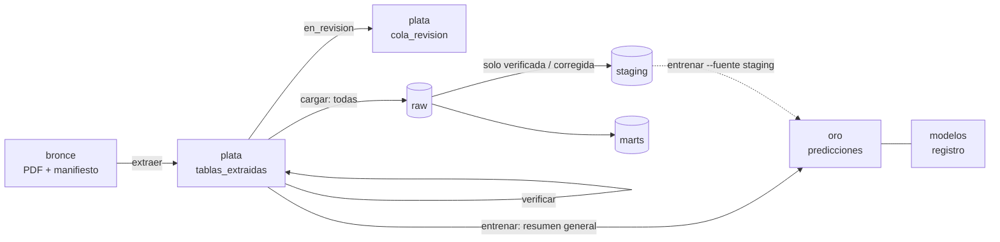

# Diccionario de datos

Describe cada campo que el sistema guarda, desde el PDF descargado hasta las vistas de
consumo en PostgreSQL. `tests/test_diccionario_datos.py` compara este documento con los
esquemas reales: si una columna cambia en el código y no aquí, la prueba falla.

## Conceptos comunes

- **Clave de tabla**: `sha256` + `pagina` + `tabla`. Identifica una tabla en todas las capas.
  `sha256` es el hash del contenido del PDF, así que el mismo PDF publicado en dos URL se
  procesa una sola vez.
- **`estado_verificacion`**: `pendiente` (recién extraída), `verificada` (aceptada sin
  cambios), `corregida` (aceptada después de rectificarla), `en_revision` (requiere una
  persona). Solo `verificada` y `corregida` llegan a `staging`.
- **Formato largo**: una fila por celda. Las tablas de un mismo PDF tienen anchos distintos y
  encabezados partidos en varias celdas, así que un esquema ancho y fijo no las contiene. Las
  columnas con significado (categoría, peso, precio) se derivan al construir las variables
  del modelo.
- **Fechas y horas**: `fecha` es la fecha de la subasta (puede faltar si no se pudo
  resolver); las marcas de tiempo están en UTC.

## Data Lake (`data/`)

### `bronce.manifiesto`

`data/bronce/manifiesto.jsonl`, un objeto JSON por URL descargada (una URL se registra una sola vez). Los PDF están en
`data/bronce/pdfs/<sha256>.pdf` y no se modifican.

| Campo | Tipo | Descripción |
|---|---|---|
| `url` | texto | URL de la que se descargó el PDF. |
| `sha256` | texto | Hash SHA-256 del contenido del PDF. |
| `ruta` | texto | Ruta del PDF dentro de `data/bronce/`. |
| `bytes` | entero | Tamaño del PDF. |
| `fecha` | fecha o nulo | Fecha de la subasta resuelta por el recolector. |
| `especial` | booleano | Subasta especial (fuera del calendario semanal). |
| `descargado_en` | marca de tiempo | Momento de la descarga. |

### `plata.tablas_extraidas`

Tabla Delta en `data/plata/tablas_extraidas`, una fila por celda, particionada por
`anio`/`mes`.

| Columna | Tipo | Descripción |
|---|---|---|
| `sha256` | string | Hash del PDF de origen (clave de tabla). |
| `fecha` | date | Fecha de la subasta; nula si no se resolvió. |
| `anio` | int32 | Año de `fecha` (partición). |
| `mes` | int32 | Mes de `fecha` (partición). |
| `especial` | bool | Subasta especial. |
| `pagina` | int32 | Página del PDF, desde 1 (clave de tabla). |
| `tabla` | int32 | Orden de la tabla en la página, desde 1 (clave de tabla). |
| `fila` | int32 | Índice original de la fila en el extractor; las filas vacías se omiten. |
| `columna` | int32 | Índice de la columna, desde 0. |
| `valor` | string | Texto de la celda; nulo si la celda no existía. |
| `ajustes` | string | JSON con los ajustes de pdfplumber que produjeron la tabla. |
| `estado_verificacion` | string | Estado de la tabla (ver «Conceptos comunes»). |
| `extraido_en` | timestamp UTC | Momento de la extracción o de la última rectificación. |

### `plata.cola_revision`

Tabla Delta en `data/plata/cola_revision`: tablas que el verificador no pudo resolver.

| Columna | Tipo | Descripción |
|---|---|---|
| `sha256` | string | Hash del PDF (clave de tabla). |
| `pagina` | int32 | Página (clave de tabla). |
| `tabla` | int32 | Tabla en la página (clave de tabla). |
| `motivo` | string | Razón por la que necesita revisión humana. |
| `hallazgos` | string | Lista JSON de las diferencias encontradas. |
| `intentos` | int32 | Rectificaciones intentadas antes de rendirse. |
| `creado_en` | timestamp UTC | Momento en que entró a la cola. |

### Precios por categoría (variables del modelo)

No se guardan como tabla: `prediccion-ganadera entrenar` los deriva en cada entrenamiento
de la tabla «RESUMEN GENERAL DE LA FERIA» (página 1 de cada PDF) en plata o `staging`. La
tabla se reconoce por ese título entre sus primeras filas o, si el título quedó fuera de
ella, por una fila de sección que empieza con `GANADO HEMBRA` o `GANADO MACHO`. Cada
fila de esa tabla une sus celdas; los últimos seis números son animales, peso por cabeza
(kg), precio mínimo, máximo y promedio y valor por animal, y las letras anteriores son la
categoría (`VACA HO` + `RRA` → `VACA HORRA`). Los precios están en pesos por kilo, salvo las
categorías rematadas por cabeza (peso 1: `MULETO`, `MACHO`), que el modelo deja fuera. Una
fila se descarta, con su motivo, si el promedio no está entre el mínimo y el máximo, si el
valor por animal difiere más de 5 % de peso × precio o si le faltan columnas.

### `oro.predicciones`

Tabla Delta en `data/oro/predicciones`: una fila por versión del modelo × fecha futura ×
categoría, escrita una vez por versión.

| Columna | Tipo | Descripción |
|---|---|---|
| `version` | string | Versión del modelo en `data/modelos/` que hizo la predicción. |
| `generado_en` | timestamp UTC | Momento del entrenamiento. |
| `fecha_referencia` | date | Última subasta conocida al predecir. |
| `fecha` | date | Viernes de subasta predicho. |
| `categoria` | string | Categoría de ganado. |
| `horizonte` | int32 | Subastas (semanas) entre la referencia y la fecha predicha. |
| `ultimo_precio` | float64 | Último precio promedio conocido de la categoría ($/kg). |
| `precio_predicho` | float64 | Precio promedio esperado ($/kg). |
| `variacion_esperada` | float64 | `precio_predicho / ultimo_precio - 1`. |
| `error_esperado` | float64 | Error absoluto medio de la validación temporal para ese horizonte ($/kg). |
| `confianza` | string | `alta`, `media` o `baja` (ver README, «Modelo predictivo»). |

### `modelos.registro`

`data/modelos/registro.jsonl`, un objeto JSON por entrenamiento. Cada versión tiene su
carpeta `data/modelos/<version>/` con `modelo.json` (booster XGBoost) y `metadatos.json`
(rango de fechas, huella de los datos, variables, parámetros, métricas por horizonte y
motivos de la confianza), más `resumen.json`: el resumen del modelado (`ResumenModelado`:
fuente, descartes, métricas, confianza y recomendaciones), que es la entrada del agente
reportero.

| Campo | Tipo | Descripción |
|---|---|---|
| `version` | texto | Marca de tiempo UTC del entrenamiento (`AAAAMMDDTHHMMSSZ`, con sufijo si se repite). |
| `creado_en` | marca de tiempo | Momento del entrenamiento. |
| `confianza` | texto | Nivel de confianza del modelo. |
| `mae` | número | Error absoluto medio de la validación temporal ($/kg). |
| `mejora` | número | `1 - mae / mae de la línea base` (último precio conocido). |

## PostgreSQL

Lo crean y actualizan `prediccion-ganadera cargar` y `prediccion-ganadera run`
([DDL](../src/prediccion_ganadera/adaptadores/almacen/esquema_postgres.sql)). La carga es
idempotente: cada tabla lleva una `huella` y solo se reescriben las que cambiaron.

### `raw.tablas`

Una fila por tabla de plata, sin importar su verificación. Clave primaria: clave de tabla.

| Columna | Tipo | Descripción |
|---|---|---|
| `sha256` | text | Hash del PDF. |
| `pagina` | integer | Página del PDF. |
| `tabla` | integer | Tabla en la página. |
| `fecha` | date | Fecha de la subasta. |
| `especial` | boolean | Subasta especial. |
| `estado_verificacion` | text | Estado de la tabla en plata al momento de la carga. |
| `ajustes` | jsonb | Ajustes del extractor. |
| `filas` | integer | Número de filas guardadas. |
| `columnas` | integer | Número de columnas (la más alta guardada + 1). |
| `huella` | text | SHA-256 del contenido, el estado y los metadatos; detecta cambios. |
| `extraido_en` | timestamptz | Última extracción o rectificación en plata. |
| `cargado_en` | timestamptz | Última vez que esta fila cambió en Postgres. |

### `raw.celdas`

Celdas de `raw.tablas`. Clave primaria: clave de tabla + `fila` + `columna`.

| Columna | Tipo | Descripción |
|---|---|---|
| `sha256` | text | Hash del PDF. |
| `pagina` | integer | Página. |
| `tabla` | integer | Tabla en la página. |
| `fila` | integer | Índice de la fila. |
| `columna` | integer | Índice de la columna. |
| `valor` | text | Texto de la celda. |

### `staging.tablas`

Solo las tablas `verificada` o `corregida`. Si una tabla deja de estarlo, sale de aquí.

| Columna | Tipo | Descripción |
|---|---|---|
| `sha256` | text | Hash del PDF. |
| `pagina` | integer | Página. |
| `tabla` | integer | Tabla en la página. |
| `fecha` | date | Fecha de la subasta. |
| `especial` | boolean | Subasta especial. |
| `estado_verificacion` | text | `verificada` o `corregida`. |
| `filas` | integer | Número de filas. |
| `columnas` | integer | Número de columnas. |
| `huella` | text | Huella de la versión cargada. |
| `cargado_en` | timestamptz | Momento en que entró a staging. |

### `staging.celdas`

Celdas de `staging.tablas`, con la misma estructura que `raw.celdas`.

| Columna | Tipo | Descripción |
|---|---|---|
| `sha256` | text | Hash del PDF. |
| `pagina` | integer | Página. |
| `tabla` | integer | Tabla en la página. |
| `fila` | integer | Índice de la fila. |
| `columna` | integer | Índice de la columna. |
| `valor` | text | Texto de la celda. |

### `marts.cobertura_subastas`

Vista: una fila por PDF con el avance de su verificación.

| Columna | Tipo | Descripción |
|---|---|---|
| `sha256` | text | Hash del PDF. |
| `fecha` | date | Fecha de la subasta. |
| `especial` | boolean | Subasta especial. |
| `tablas` | integer | Tablas extraídas del PDF. |
| `tablas_validadas` | integer | Tablas `verificada` o `corregida`. |
| `tablas_pendientes` | integer | Tablas `pendiente`. |
| `tablas_en_revision` | integer | Tablas `en_revision`. |
| `filas_validadas` | integer | Filas de las tablas validadas. |
| `cargado_en` | timestamptz | Último cambio cargado de ese PDF. |

### `operacion.runs`

Una fila por corrida del orquestador (`prediccion-ganadera run`), escrita al iniciar, al
reanudar y al terminar o caer (upsert por `id_corrida`). La misma información queda,
versión por versión, en `data/corridas/corridas.jsonl`.

| Columna | Tipo | Descripción |
|---|---|---|
| `id_corrida` | text | Identificador de la corrida y del hilo del checkpointer. |
| `estado` | text | `en_curso`, `completada`, `fallida` (error esperado de un paso) o `interrumpida` (el proceso cayó; se puede reanudar). |
| `iniciada_en` | timestamptz | Inicio de la corrida; se conserva al reanudar. |
| `actualizada_en` | timestamptz | Última escritura del registro. |
| `terminada_en` | timestamptz | Fin de una corrida `completada` o `fallida`; nulo en otro caso. |
| `tokens` | integer | Tokens de IA consumidos por todos los pasos. |
| `costo_usd` | double precision | Costo reportado por los backends de IA (0 para IA local). |
| `error` | text | Motivo de `fallida` o `interrumpida`. |
| `pasos` | jsonb | Por paso terminado: `resumen`, `omitido`, `tokens`, `costo_usd`, `duracion_s`. |
